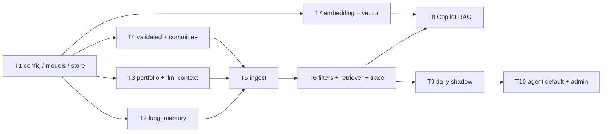

# PR Dependency Map

## 总体依赖主线

真实阻塞依赖：

- Task 1 阻塞所有 RAG 模块。
- Task 2/3/4 阻塞 Task 5 的完整 ingest。
- Task 5 阻塞 Task 6 的真实检索测试。
- Task 6 阻塞 Task 8/9，因为 no-future、fund-match、memory visibility 必须先落地。
- Task 7 不阻塞 SQLite/FTS/mock 检索，但阻塞真实向量召回上线。
- Task 8 不阻塞 Task 9，但建议先让 Copilot 消费 RAG，风险更小。
- Task 9 shadow 稳定后才允许 Task 10 默认接入。

## PR 列表

| PR | 所属 Task | 标题 | 阻塞依赖 | 风险等级 |
|---|---|---|---|---|
| PR-01 | T1 | `config/rag.toml`、开关、目录约定、默认 disabled | 无 | 低 |
| PR-02 | T1 | `rag_models.py` 数据结构与字段校验 | PR-01 | 中 |
| PR-03 | T1 | `rag_index_store.py`、SQLite schema、manifest/trace 表骨架 | PR-02 | 中 |
| PR-04 | T2 | long_memory 读取 SQLite，生成标准 document/chunk | PR-02 | 中 |
| PR-05 | T2 | memory visibility/status/valid_from/valid_until/superseded 过滤测试 | PR-04 | 高 |
| PR-06 | T3 | portfolio current/snapshot adapter，保留 numeric payload | PR-02 | 中 |
| PR-07 | T3 | llm_context/evidence_items adapter，fund_codes 显式映射 | PR-02 | 中 |
| PR-08 | T4 | validated_advice adapter，action/market/cross-fund 可引用 | PR-02 | 中 |
| PR-09 | T4 | committee_bundle adapter，缺文件返回 missing 不阻断 | PR-02 | 中 |
| PR-10 | T5 | `rag_ingest.py --dry-run`，只汇总 doc/chunk/error | PR-03/04/06/07/08/09 | 中 |
| PR-11 | T5 | `--write`、幂等写入、source_manifest、active manifest 切换 | PR-10 | 高 |
| PR-12 | T6 | QueryPlan + hard filters: no-future/fund-match/memory/execution | PR-11 | 高 |
| PR-13 | T6 | SQLite/FTS/mock retriever + missingData 语义 | PR-12 | 高 |
| PR-14 | T6 | `rag_trace.py` + trace 落盘 + rejected_samples | PR-13 | 高 |
| PR-15 | T7 | embedding config/probe/dry-run/mock fallback | PR-03 | 中 |
| PR-16 | T7 | embedding cache by model+text hash，unchanged chunk 不重复请求 | PR-15/11 | 中 |
| PR-17 | T7 | vector store adapter，先接 mock/Chroma，业务只依赖接口 | PR-16/13 | 中 |
| PR-18 | T8 | `app/rag_service.py`/`rag_answering.py` 构造 evidence pack | PR-14 | 高 |
| PR-19 | T8 | `web_api.py`/`copilot_service.py` 接入，保留 fallback | PR-18 | 高 |
| PR-20 | T8 | 前端类型/API/CopilotPanel 接收 citations/traceId/retrieval | PR-19 | 中 |
| PR-21 | T9 | pipeline 可选 rag_ingest/rag_eval，不注入 prompt | PR-14/11 | 高 |
| PR-22 | T9 | `agent_inputs.py` 写 shadow 字段，agent trace/diff artifact | PR-21 | 高 |
| PR-23 | T9 | `rag_eval.py` legacy/RAG 对比指标 | PR-22 | 高 |
| PR-24 | T10 | agent_profiles 配置 + legacy fallback + workflow_meta manifest sha | PR-23 | 高 |
| PR-25 | T10 | `rag_maintenance.py` + admin/status API/系统页可观测性 | PR-24/14 | 中 |
| PR-26 | Later | decision/memory/review/replay profiles | PR-24 | 高 |
| PR-27 | Later | execution profile 隐私隔离 | PR-24，单独安全评审 | 高 |

## 推荐批次

### Batch A：底座

目标：新增 RAG 基础能力，但默认关闭，不影响当前运行。

包含：PR-01、PR-02、PR-03。

质量门：

- 删除或禁用 `config/rag.toml` 后，Copilot 和 daily pipeline 行为不变。
- `db/rag/rag.sqlite` 初始化不需要网络、不需要 API key。

### Batch B：source adapters

目标：把已有本地证据变成统一 RAG document/chunk。

包含：PR-04、PR-05、PR-06、PR-07、PR-08、PR-09。

质量门：

- `execution_sync` 默认不 ingest。
- archived/rejected 默认不进入普通 profile。
- portfolio 数值事实保留在 payload。

### Batch C：ingest

目标：dry-run 与 write 都可重复执行，manifest 能反映 source 状态。

包含：PR-10、PR-11。

质量门：

- 重复运行 unchanged chunk 不重复写入。
- 任一 adapter 失败只记录 manifest error，不影响其他 adapter。

### Batch D：检索安全层

目标：实现硬过滤、retriever、trace，这是 Copilot 和 daily 接入前的强制门槛。

包含：PR-12、PR-13、PR-14。

质量门：

- no-future 违规数为 0。
- 明确 fund_code 主证据错配数为 0。
- 普通 profile execution 误召回数为 0。

### Batch E：embedding/vector

目标：真实 embedding 可用，但失败时 mock/FTS fallback 可用。

包含：PR-15、PR-16、PR-17。

质量门：

- 无 API key 时 dry-run/mock 通过。
- embedding 失败不阻断旧链路。

### Batch F：Copilot RAG

目标：右侧助手优先消费 RAG，答案可引用、可追踪、可回退。

包含：PR-18、PR-19、PR-20。

质量门：

- API 仍兼容旧 `answer/mode/sourceDate`。
- RAG 异常 fallback 到旧页面上下文。

### Batch G：daily shadow

目标：RAG 与旧 `evidence_index.py` 并行跑，不改变最终建议。

包含：PR-21、PR-22、PR-23。

质量门：

- shadow 开启后 `validated_advice` 不因 RAG 改变。
- 每个 agent 有 `trace_id` 和 legacy/RAG diff。

### Batch H：默认接入与可观测

目标：在 shadow 稳定后，按 agent profile 默认用 RAG，并提供维护界面/API。

包含：PR-24、PR-25。

质量门：

- 关闭 RAG 后旧链路完全可用。
- 系统页能查看 RAG enabled/shadow/fallback、最近 ingest、doc count、trace、eval。
