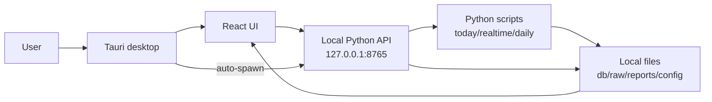
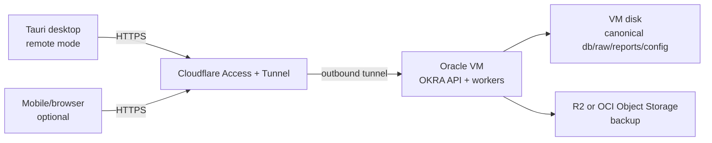
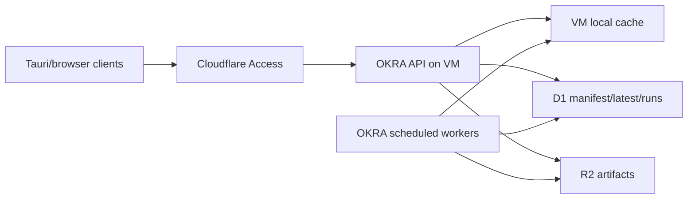

# OKRA Cloud Migration Plan

Status: planning baseline
Date: 2026-06-15
Owner: OKRA Workbench

This document is the development guide for moving OKRA from a local-first
desktop workbench to a cloud-backed, multi-device workbench while keeping the
current Tauri desktop app usable.

Confirmed direction:

- Do not use Tailscale.
- Ignore LLM/API call cost in this migration plan.
- Cloud may store real portfolio and execution data.
- Keep the desktop app, but make it dual-mode: local mode and remote API mode.
- Land Phase A first, then progressively evolve into Phase B.

## 1. Target Summary

Recommended route:

```text
Phase A:
  Oracle Cloud Always Free VM
    -> runs app/web_api.py
    -> runs scheduled OKRA pipeline jobs
    -> stores canonical db/raw/reports/config on VM disk first
  Cloudflare Tunnel + Cloudflare Access
    -> authenticated HTTPS without opening inbound VM ports
  Tauri desktop dual-mode
    -> local mode: current 127.0.0.1:8765 behavior
    -> remote mode: VITE_OKRA_API_BASE=https://okra.<domain>
  R2 or OCI Object Storage backup
    -> daily encrypted/offsite backup of durable state

Phase B:
  VM remains the writer/worker
  Cloudflare R2 becomes artifact storage
  Cloudflare D1 becomes manifest/latest-state/run-lock index
  API reads through a storage abstraction with local cache
```

Phase A is the first production target. Phase B should not start until Phase A
has at least one stable week of daily/realtime runs and a tested restore path.

## 2. Current Main Chain

Current desktop-first chain:

```text
run_desktop_app.ps1
  -> frontend/src-tauri/src/lib.rs
     -> probes 127.0.0.1:8765/api/health
     -> auto-spawns app/web_api.py --home <repo-root>
  -> frontend/src/lib/api.ts
     -> VITE_OKRA_API_BASE or http://127.0.0.1:8765
  -> app/web_api.py
  -> app/web_api_services.py / app/ui_tasks.py / app/ui_support.py
  -> scripts/run_today_analysis.py
  -> scripts/today_orchestrator.py
  -> scripts/run_daily_pipeline.py
  -> db/, raw/, reports/, logs/, cache/, temp/
```

Important repo anchors:

- `run_desktop_app.ps1`: current user-facing desktop launcher.
- `frontend/src-tauri/src/lib.rs`: Tauri backend process bootstrap.
- `frontend/src/lib/api.ts`: frontend API base selection.
- `app/web_api.py`: backend HTTP entrypoint.
- `app/web_api_services.py`: page/API service assembly and runtime actions.
- `app/ui_tasks.py`: task trigger helpers.
- `app/ui_support.py`: file-backed state loader and payload builder.
- `scripts/run_today_analysis.py`: current top-level today-analysis command.
- `scripts/today_orchestrator.py`: runtime coordination and locking.
- `scripts/run_daily_pipeline.py`: canonical daily pipeline.
- `scripts/fetch_fund_news.py`: cloud migration risk because it can depend on
  local browser cookies/profiles for `xueqiu_web` and `douyin_web`.
- `config/settings.toml`: current data-source and browser-cookie settings.

The core architectural fact is that OKRA currently behaves like an artifact
workbench. Most state is JSON/Markdown/SQLite-like files organized by date and
domain, not a normalized online database.

## 3. Non-Goals

Do not include these in the first implementation pass:

- Rewriting the Python backend into FastAPI, Django, serverless functions, or a
  new framework.
- Moving every JSON artifact into Postgres/Mongo/Firestore.
- Building a full multi-user SaaS permission model.
- Replacing Tauri with a browser-only product.
- Solving paid LLM/API cost.
- Using Tailscale or another VPN-first topology.
- Opening the VM API port directly to the public internet.

## 4. Provider Decision

### 4.1 Shortlist

| Rank | Provider path | Role | Decision |
|---:|---|---|---|
| 1 | Oracle Cloud Always Free VM | backend worker + API | Primary Phase A target |
| 2 | Google Cloud e2-micro Always Free | backup VM path | Use only if Oracle capacity/account fails |
| 3 | Cloudflare Tunnel + Access | secure public ingress | Required for no-Tailscale route |
| 4 | Cloudflare R2 | backup now, artifact store later | Phase A backup, Phase B storage |
| 5 | Cloudflare D1 | manifest/run index | Phase B only |
| 6 | Supabase | future users/permissions/metadata | Optional later, not primary store |

### 4.2 Rejected For Primary Backend

| Option | Why not primary now |
|---|---|
| Render free web service | Free filesystem is ephemeral; OKRA writes durable local files. |
| Koyeb free service | Free instance is too small for current Python pipeline shape. |
| Fly.io | No general free account/free tier for new production use. |
| Railway | Free/credit model is not a stable always-free production backend. |
| Cloudflare Workers | Great gateway/static/runtime product, but not for Python subprocess pipeline. |
| Cloud Run / Azure Container Apps | Useful after stateless refactor; not the first fit for file locks and long jobs. |
| Supabase/Neon as primary DB | Current artifact footprint is already close to free DB limits. |
| MongoDB Atlas free | 512 MB class storage is too tight and does not match artifact layout. |
| Firebase/Firestore | Strong realtime document product, but would force a major data-model rewrite. |

### 4.3 Source Links To Recheck Before Provisioning

Provider limits change. Recheck these before creating resources:

- Oracle Always Free:
  https://docs.oracle.com/en-us/iaas/Content/FreeTier/freetier_topic-Always_Free_Resources.htm
- Google Cloud Free Tier:
  https://docs.cloud.google.com/free/docs/free-cloud-features
- Cloudflare Tunnel:
  https://developers.cloudflare.com/cloudflare-one/networks/connectors/cloudflare-tunnel/
- Cloudflare Access:
  https://www.cloudflare.com/sase/products/access/
- Cloudflare R2 pricing:
  https://developers.cloudflare.com/r2/pricing/
- Cloudflare D1 pricing:
  https://developers.cloudflare.com/d1/platform/pricing/
- Cloudflare Workers pricing:
  https://developers.cloudflare.com/workers/platform/pricing/
- Render free limits:
  https://render.com/docs/free
- Koyeb instance reference:
  https://www.koyeb.com/docs/reference/instances
- Fly.io cost management:
  https://fly.io/docs/about/cost-management/
- Supabase pricing:
  https://supabase.com/pricing
- Neon pricing:
  https://neon.com/pricing

## 5. Architecture

### 5.1 Current Local Architecture



### 5.2 Phase A Target Architecture



Phase A rules:

- Only the VM writes canonical state.
- All clients read/write through the cloud API.
- The VM API listens on localhost or private interface.
- Cloudflare Tunnel is the public ingress.
- Cloudflare Access protects both frontend and API.
- Durable local files are backed up every day.

### 5.3 Phase B Target Architecture



Phase B rules:

- R2 stores large immutable or versioned artifacts.
- D1 stores only small structured metadata.
- The VM remains the only writer until a distributed-write model is explicitly
  designed.
- API supports local-cache reads for speed, but cloud object/index state becomes
  the recoverable source of truth.

## 6. Security Model

### 6.1 Data Classification

| Class | Examples | Storage policy | Access policy |
|---|---|---|---|
| Public-ish derived market data | normalized news, research summaries | R2/VM allowed | authenticated only |
| Private portfolio state | `db/portfolio_state`, holdings, cost basis | private bucket/prefix, VM disk | authenticated + API token/JWT |
| Execution records | `db/execution_sync`, actual trades, confirmations | private bucket/prefix, encrypted backup | strongest protection |
| Secrets | API keys, cookies, Cloudflare/OCI tokens | never in git, never in R2 artifact bucket | VM env/secret files only |
| Runtime logs | logs, error traces | retention-limited | authenticated admin only |

### 6.2 Phase A Protection

Required:

- Cloudflare Access in front of the public hostname.
- Cloudflare Tunnel with no public inbound VM API port.
- VM firewall denies inbound except SSH from controlled source if SSH is needed.
- API write endpoints require an additional server-side secret, even behind
  Access.
- CORS origin allowlist is domain-based, not broad wildcard.
- Secrets are stored in `/etc/okra/okra.env` or equivalent, not in repo files.
- Backups exclude `.env`, API keys, browser profile directories, and raw cookie
  dumps unless explicitly encrypted.

Recommended:

- Verify Cloudflare Access JWT or at least verify Access identity headers on
  sensitive endpoints.
- Separate read endpoints from command endpoints.
- Add audit logs for write actions:
  `/api/run/daily`, `/api/run/realtime`, `/api/execution-sync/*`,
  `/api/long-memory/action`, `/api/rag/*`, `/api/copilot/explain`.
- Add a kill-switch env var:
  `OKRA_DISABLE_REMOTE_MUTATIONS=1`.

### 6.3 Phase B Protection

Required:

- R2 bucket private by default.
- D1 not exposed directly to clients.
- R2 object keys never include raw secrets.
- Manifest rows include sha256 and size for tamper detection.
- Backup restore must verify checksums.

## 7. Phase A Development Plan

### A0. Baseline Audit

Goal: know exactly what will move to the VM and what stays local.

Tasks:

- [ ] Record current branch, dirty files, and latest commit.
- [ ] Produce a cloud-readiness inventory:
  - [ ] `db/`
  - [ ] `raw/`
  - [ ] `reports/`
  - [ ] `config/`
  - [ ] `logs/`
  - [ ] `cache/`
  - [ ] `temp/`
- [ ] Mark durable state vs rebuildable state using `docs/INDEX.md` retention
  rules.
- [ ] Identify secrets that must not be copied to git or object storage.
- [ ] Run current local smoke checks.
- [ ] Save a baseline backup before any code change.

Suggested commands:

```powershell
git status --short
python -B -X utf8 -m py_compile app\web_api.py app\web_api_services.py app\ui_support.py scripts\today_orchestrator.py scripts\run_daily_pipeline.py
python -B -X utf8 scripts\preflight_check.py --scope desktop
cd frontend
npm run build
npm run tauri:check
```

Acceptance:

- Current desktop local mode still starts.
- `/api/health`, `/api/today`, `/api/system`, and `/api/dates` work locally.
- Durable and rebuildable directories are explicitly listed.

### A1. Add Desktop Dual Mode

Goal: keep current local desktop flow while supporting a remote API backend.

Required behavior:

```text
OKRA_DESKTOP_MODE=local
  -> current behavior
  -> Tauri probes/spawns local app/web_api.py
  -> frontend API base defaults to http://127.0.0.1:8765

OKRA_DESKTOP_MODE=remote
  -> Tauri does not spawn local app/web_api.py
  -> frontend uses VITE_OKRA_API_BASE or OKRA_REMOTE_API_BASE
  -> health diagnostics show remote target

unset mode
  -> local mode for backward compatibility
```

Implementation tasks:

- [ ] Add a small mode helper in `frontend/src-tauri/src/lib.rs`.
- [ ] Skip `spawn_api()` when mode is `remote`.
- [ ] Make local API probe configurable only for local mode.
- [ ] Add startup log lines that show mode and API base without leaking secrets.
- [ ] In `frontend/src/lib/api.ts`, keep `VITE_OKRA_API_BASE` as the browser
  build-time API base.
- [ ] Add `.env.remote.example` under `frontend/`:

```text
VITE_OKRA_API_BASE=https://okra.example.com
```

- [ ] Add a root-level remote launcher script:
  `run_desktop_app_remote.ps1`.
- [ ] Document both modes in `docs/modern_workbench.md` after implementation.

Tests:

```powershell
cd frontend
npm run build
npm run tauri:check

$env:OKRA_DESKTOP_MODE="local"
.\run_desktop_app.ps1

$env:OKRA_DESKTOP_MODE="remote"
$env:VITE_OKRA_API_BASE="https://okra.example.com"
.\run_desktop_app_remote.ps1
```

Acceptance:

- Local mode is unchanged.
- Remote mode never starts a local Python backend.
- Remote mode displays a clear API connectivity error if the cloud API is not
  reachable.

### A2. Harden API For Remote Access

Goal: prevent a local-only API from becoming an unsafe internet API.

Implementation tasks:

- [ ] Add config/env:
  - [ ] `OKRA_PUBLIC_BASE_URL`
  - [ ] `OKRA_ALLOWED_ORIGINS`
  - [ ] `OKRA_API_TOKEN`
  - [ ] `OKRA_TRUST_CLOUDFLARE_ACCESS`
  - [ ] `OKRA_DISABLE_REMOTE_MUTATIONS`
- [ ] Split endpoint policy into:
  - [ ] read endpoints
  - [ ] mutation endpoints
  - [ ] admin/debug endpoints
- [ ] Require bearer token or verified Access identity for mutation endpoints.
- [ ] Keep `/api/health` safe and non-sensitive.
- [ ] Ensure error envelopes never leak local paths/secrets in production mode.
- [ ] Add request/audit logging for mutation endpoints.
- [ ] Add tests for forbidden origins and missing auth.

Suggested endpoint policy:

| Endpoint group | Auth requirement |
|---|---|
| `/api/health` | public through Access, no sensitive payload |
| `/api/dates`, page reads, fund detail | Cloudflare Access |
| `/api/run/*` | Access + API token/JWT |
| `/api/execution-sync/*` | Access + API token/JWT |
| `/api/long-memory/action` | Access + API token/JWT |
| `/api/rag/*` admin/debug | Access + API token/JWT |
| `/api/copilot/explain` | Access; token if it can expose private state |

Tests:

```powershell
python -B -X utf8 -m unittest tests.test_web_api_long_memory tests.test_execution_sync
python -B -X utf8 -m unittest discover -s tests -p "test_*web_api*.py"
```

Acceptance:

- Local desktop still works without remote auth friction.
- Remote protected endpoints reject unauthenticated mutation requests.
- CORS allowlist supports local origins and configured cloud origin only.

### A3. Add Deployable Runtime Files

Goal: make the backend reproducible on a Linux VM.

Files to add:

- [ ] `deploy/systemd/okra-api.service`
- [ ] `deploy/systemd/okra-daily.service`
- [ ] `deploy/systemd/okra-daily.timer`
- [ ] `deploy/systemd/okra-realtime.service`
- [ ] `deploy/systemd/okra-realtime.timer`
- [ ] `deploy/cloudflared/config.example.yml`
- [ ] `deploy/caddy/Caddyfile.example`
- [ ] `deploy/env/okra.env.example`
- [ ] `deploy/scripts/bootstrap_ubuntu.sh`
- [ ] `deploy/scripts/healthcheck.sh`
- [ ] `deploy/scripts/backup_artifacts.sh`
- [ ] `deploy/scripts/restore_artifacts.sh`

`okra.env.example` should include placeholders only:

```bash
FUND_AGENT_HOME=/opt/okra_assistant
PYTHONIOENCODING=utf-8
PYTHONDONTWRITEBYTECODE=1
OKRA_PUBLIC_BASE_URL=https://okra.example.com
OKRA_ALLOWED_ORIGINS=https://okra.example.com,tauri://localhost,http://tauri.localhost
OKRA_API_TOKEN=replace-with-long-random-token
OKRA_TRUST_CLOUDFLARE_ACCESS=1
OKRA_DISABLE_REMOTE_MUTATIONS=0
```

`okra-api.service` shape:

```ini
[Unit]
Description=OKRA API
After=network-online.target
Wants=network-online.target

[Service]
Type=simple
WorkingDirectory=/opt/okra_assistant
EnvironmentFile=/etc/okra/okra.env
ExecStart=/opt/okra_assistant/.venv/bin/python -B -X utf8 app/web_api.py --home /opt/okra_assistant --host 127.0.0.1 --port 8765
Restart=on-failure
RestartSec=5

[Install]
WantedBy=multi-user.target
```

If `app/web_api.py` does not support `--host`, add it before deploying. Default
must remain local-safe.

Acceptance:

- A clean VM can install dependencies and start the API using documented files.
- systemd logs show a healthy API.
- `deploy/` examples contain no real secrets.

### A4. Provision Oracle VM

Goal: create the cloud host without accidental paid resources.

Checklist:

- [ ] Create Oracle Cloud account.
- [ ] Choose home region carefully; Always Free resource availability is region
  dependent.
- [ ] Create Ampere A1 or AMD micro instance within Always Free limits.
- [ ] Use Ubuntu LTS.
- [ ] Keep boot/block volume within Always Free quota.
- [ ] Do not attach paid GPUs, load balancers, or managed databases.
- [ ] Add billing alerts if the account supports them.
- [ ] Add SSH key auth; disable password login.
- [ ] Update packages.
- [ ] Install Python, Node only if building frontend on VM, git, rsync/rclone,
  cloudflared, Caddy if using same-domain static serving.
- [ ] Clone or sync this repository to `/opt/okra_assistant`.
- [ ] Create Python venv and install `requirements.txt`.

Fallback path:

- [ ] If Oracle capacity is unavailable, repeat with Google Cloud e2-micro.
- [ ] On GCP, verify region, disk type, and egress limits before relying on
  Always Free.

Acceptance:

- VM can run:

```bash
cd /opt/okra_assistant
. .venv/bin/activate
python -B -X utf8 app/web_api.py --home . --host 127.0.0.1 --port 8765
curl http://127.0.0.1:8765/api/health
```

### A5. Cloudflare Tunnel + Access

Goal: expose the VM safely without Tailscale and without public inbound API
ports.

Tasks:

- [ ] Put the chosen domain on Cloudflare DNS.
- [ ] Create Zero Trust organization.
- [ ] Create Access application for `https://okra.<domain>`.
- [ ] Restrict access to your email first.
- [ ] Install and authenticate `cloudflared` on VM.
- [ ] Create tunnel:
  `okra-prod`.
- [ ] Configure route:
  `okra.<domain> -> http://127.0.0.1:8765` or `http://127.0.0.1:8080`
  if Caddy serves frontend and proxies API.
- [ ] Run tunnel as a service.
- [ ] Confirm VM firewall allows outbound and blocks inbound API.

Two serving choices:

Option A, simplest:

```text
Cloudflare Tunnel -> app/web_api.py
React assets are still packaged inside Tauri for desktop.
Mobile/browser web app can be added later.
```

Option B, better for browser access:

```text
Cloudflare Tunnel -> Caddy
Caddy serves frontend/dist at /
Caddy reverse-proxies /api/* to 127.0.0.1:8765
```

Recommended Phase A choice: Option B if you want phone/browser viewing soon;
Option A if the first target is only Tauri remote mode.

Acceptance:

- `https://okra.<domain>/api/health` requires Access login.
- After login, health returns OK.
- Direct `http://<vm-ip>:8765` is not reachable from the internet.

### A6. Move Canonical State To VM Disk

Goal: make the cloud VM the only writer.

Tasks:

- [ ] Stop local scheduled runs.
- [ ] Take local backup.
- [ ] Copy durable state to VM:
  - [ ] `db/long_memory/`
  - [ ] `db/execution_sync/`
  - [ ] `db/portfolio_state/`
  - [ ] `db/validated_advice/`
  - [ ] `db/decision_ledger/`
  - [ ] `db/decision_latest/`
  - [ ] `db/decisions/`
  - [ ] required `raw/news/`
  - [ ] required `reports/daily/`
  - [ ] safe config files
- [ ] Do not copy local browser profiles.
- [ ] Do not copy secrets into git-tracked config.
- [ ] Decide how to handle `xueqiu_web` / `douyin_web`:
  - [ ] disable initially on cloud, or
  - [ ] provide explicit cookie files, or
  - [ ] keep those sources local-only until a stable cloud-safe source path is
    designed.
- [ ] Run `scripts/cleanup_retention.py --dry-run --assert-protected --report`
  before copying rebuildable material.

Acceptance:

- VM API can render latest Today/Portfolio/Execution pages from copied state.
- Local machine is no longer required for viewing.
- Cloud pipeline can run without depending on local browser profile paths.

### A7. Schedule Cloud Pipeline

Goal: cloud backend updates itself.

Tasks:

- [ ] Create `okra-daily.timer` for market-day daily run.
- [ ] Create `okra-realtime.timer` only if realtime monitor is needed.
- [ ] Ensure only one run can execute at a time.
- [ ] Confirm `today_orchestrator.py` lock behavior works on Linux.
- [ ] Add healthcheck after each run:
  - [ ] latest artifact exists
  - [ ] `/api/today?date=<date>` loads
  - [ ] runtime status is terminal or actionable
- [ ] Add failure logs under `logs/cloud/`.
- [ ] Add notification hook later if needed.

Acceptance:

- A daily run completes on VM.
- Tauri remote mode sees the new data without local sync.
- Duplicate run attempts return the expected already-running behavior.

### A8. Add Backups And Restore Drill

Goal: real data must be recoverable.

Phase A backup scope:

- Include:
  - [ ] `db/long_memory/`
  - [ ] `db/execution_sync/`
  - [ ] `db/portfolio_state/`
  - [ ] `db/validated_advice/`
  - [ ] `db/decision_ledger/`
  - [ ] `db/decision_latest/`
  - [ ] `db/decisions/`
  - [ ] selected `raw/news/`
  - [ ] selected `reports/daily/`
  - [ ] deployment env templates without secrets
- Exclude unless encrypted:
  - [ ] API keys
  - [ ] cookie files
  - [ ] browser profiles
  - [ ] raw screenshots with account identifiers
  - [ ] huge rebuildable caches

Implementation:

- [ ] Pick R2 or OCI Object Storage as the first backup target.
- [ ] Use `rclone` or provider CLI.
- [ ] Use date-stamped prefixes:
  `backups/okra/YYYY-MM-DD/`.
- [ ] Write a manifest:
  - [ ] file count
  - [ ] total bytes
  - [ ] sha256 list or archive checksum
  - [ ] git commit hash
  - [ ] OKRA version/date
- [ ] Keep at least:
  - [ ] 7 daily backups
  - [ ] 4 weekly backups
  - [ ] 3 monthly backups

Restore drill:

- [ ] Restore into `/opt/okra_restore_test`.
- [ ] Start API against restored home.
- [ ] Check `/api/health`, `/api/today`, `/api/portfolio`, `/api/execution`.
- [ ] Compare latest key files with checksum manifest.

Acceptance:

- Restore can be completed without the original Windows machine.
- Restore result renders the latest important pages.

### A9. Release Remote Desktop Mode

Goal: make the desktop app usable against the cloud API.

Tasks:

- [ ] Build local-mode desktop artifact.
- [ ] Build remote-mode desktop artifact or document remote launcher/env.
- [ ] Add visible System page diagnostics:
  - [ ] mode: local/remote
  - [ ] API base host
  - [ ] API health
  - [ ] latest cloud run time
  - [ ] mutation enabled/disabled
- [ ] Ensure remote mode does not display stale local artifacts.
- [ ] Verify on at least:
  - [ ] Windows desktop
  - [ ] phone browser or another machine browser if Option B was chosen

Acceptance:

- You can close the local backend and still use the desktop app through cloud.
- Viewing and controlled write actions work through the remote API.
- Local mode remains available as fallback.

## 8. Phase B Development Plan

Phase B should start only after Phase A is stable. Its purpose is to reduce
dependence on VM disk as the only canonical data location.

### B0. Introduce Storage Boundary

Goal: prevent direct path reads from spreading further.

Tasks:

- [ ] Add `app/storage.py` or equivalent.
- [ ] Define operations:
  - [ ] `read_json(key)`
  - [ ] `write_json(key, payload)`
  - [ ] `read_text(key)`
  - [ ] `write_text(key, text)`
  - [ ] `exists(key)`
  - [ ] `list_prefix(prefix)`
  - [ ] `latest_by_date(prefix, date)`
  - [ ] `write_manifest(entry)`
- [ ] Implement local filesystem backend first.
- [ ] Route new cloud-aware code through this boundary.
- [ ] Do not refactor every old read at once; start with page payload reads.

Acceptance:

- Local behavior remains identical.
- Tests can swap storage backend in memory/tempdir.

### B1. Define Artifact Key Scheme

Goal: map current file paths to stable cloud object keys.

Key examples:

```text
db/validated_advice/2026-06-15.json
db/daily_workspace/2026-06-15/today_decision.json
db/daily_workspace/2026-06-15/today_analysis.json
db/realtime_monitor/2026-06-15.json
db/portfolio_state/current.json
db/portfolio_state/snapshots/2026-06-15.json
db/execution_sync/actual_trades/2026-06-15.json
raw/news/2026-06-15.json
reports/daily/2026-06-15_portfolio.md
```

Rules:

- Keep current relative paths as object keys when possible.
- Use immutable versioned keys for historical artifacts.
- Use `latest_state` pointer for current/latest views.
- Store sha256 for every artifact.
- Keep execution data in a separate prefix or bucket if practical.

Acceptance:

- Every page-critical artifact has a deterministic key.
- No secret path is included in the key map.

### B2. Add R2 Artifact Mirror

Goal: write artifacts to R2 while keeping VM disk as primary during migration.

Tasks:

- [ ] Add R2 client config:
  - [ ] endpoint
  - [ ] bucket
  - [ ] access key env var
  - [ ] secret key env var
  - [ ] region compatibility value
- [ ] Add upload script:
  `scripts/sync_artifacts_to_r2.py`.
- [ ] Upload after daily pipeline completion.
- [ ] Record sha256 and etag.
- [ ] Support dry run.
- [ ] Support prefix allowlist.

Acceptance:

- Latest day artifacts appear in R2.
- Re-running sync is idempotent.
- Restore from R2 can rebuild page-critical state.

### B3. Add D1 Manifest

Goal: store small structured indexes, not large JSON payloads.

Initial schema:

```sql
CREATE TABLE artifacts (
  id TEXT PRIMARY KEY,
  key TEXT NOT NULL,
  kind TEXT NOT NULL,
  date TEXT,
  sha256 TEXT NOT NULL,
  size_bytes INTEGER NOT NULL,
  etag TEXT,
  version INTEGER NOT NULL DEFAULT 1,
  created_at TEXT NOT NULL,
  updated_at TEXT NOT NULL
);

CREATE INDEX idx_artifacts_kind_date ON artifacts(kind, date);

CREATE TABLE latest_state (
  kind TEXT PRIMARY KEY,
  date TEXT,
  artifact_key TEXT NOT NULL,
  version INTEGER NOT NULL,
  updated_at TEXT NOT NULL
);

CREATE TABLE runs (
  run_id TEXT PRIMARY KEY,
  report_date TEXT NOT NULL,
  status TEXT NOT NULL,
  phase TEXT,
  started_at TEXT NOT NULL,
  finished_at TEXT,
  lock_token TEXT,
  metadata_json TEXT
);
```

Tasks:

- [ ] Create D1 database.
- [ ] Add migrations under `deploy/d1/migrations/`.
- [ ] Add manifest writer script.
- [ ] Write manifest rows after successful R2 uploads.
- [ ] Keep D1 writes small and batched.

Acceptance:

- D1 can answer latest artifact pointer queries.
- D1 contains no large artifact payloads.

### B4. Read Through Manifest

Goal: API reads cloud-backed latest state without losing local compatibility.

Read order during transition:

```text
1. local cache / VM filesystem
2. D1 latest pointer
3. R2 artifact
4. empty-state fallback
```

Tasks:

- [ ] Add config:
  `OKRA_STORAGE_MODE=local|mirror|cloud-read`.
- [ ] In `mirror`, local disk remains source but writes mirror to R2/D1.
- [ ] In `cloud-read`, page reads can fetch from R2/D1 if local file missing.
- [ ] Start with read-only page endpoints:
  - [ ] `/api/today`
  - [ ] `/api/portfolio`
  - [ ] `/api/execution`
  - [ ] `/api/realtime`
  - [ ] `/api/review`
- [ ] Leave mutation endpoints VM-local until write path is fully designed.

Acceptance:

- Deleting a local cache file can still render page from R2/D1.
- Existing local development still works with `OKRA_STORAGE_MODE=local`.

### B5. Cloud Writer Discipline

Goal: avoid split-brain writes.

Tasks:

- [ ] Keep one writer: the VM worker.
- [ ] Add run lock row to D1 only if needed for observability.
- [ ] Do not allow clients to write R2/D1 directly.
- [ ] Ensure API mutations write through backend only.
- [ ] Add idempotency keys for execution-sync mutations.
- [ ] Add conflict checks for portfolio/execution current state.

Acceptance:

- Two clients cannot silently overwrite execution state.
- Run and mutation audit trail is inspectable.

### B6. Retention And Cost Guardrails

Goal: stay within free tiers as long as practical.

Tasks:

- [ ] Track R2 total bytes per prefix.
- [ ] Track Class A and Class B operation trends.
- [ ] Track D1 row counts by table.
- [ ] Keep large raw snapshots compressed or pruned.
- [ ] Archive rebuildable daily workspace material after retention window.
- [ ] Keep permanent state protected.
- [ ] Add warning thresholds:
  - [ ] R2 7 GB
  - [ ] R2 9 GB
  - [ ] D1 3 GB
  - [ ] D1 4.5 GB

Acceptance:

- A monthly cost report can be generated from provider usage and local manifest.
- Retention never deletes protected directories.

### B7. Phase B Cutover

Goal: treat R2/D1 as recoverable canonical cloud data.

Tasks:

- [ ] Complete one full restore from R2/D1 into a clean VM.
- [ ] Run daily pipeline after restore.
- [ ] Compare restored API payloads with pre-cutover payloads.
- [ ] Switch `OKRA_STORAGE_MODE=cloud-read`.
- [ ] Keep VM disk cache but no longer treat it as the only backup.

Acceptance:

- A lost VM can be replaced from R2/D1 and latest backup.
- Desktop remote mode is unaffected by VM replacement after restore.

## 9. Development TODO

### Immediate TODO

- [ ] Create a branch for cloud migration work.
- [ ] Add desktop dual-mode implementation.
- [ ] Add remote launcher and frontend env example.
- [ ] Add API remote-auth config and tests.
- [ ] Add deploy examples under `deploy/`.
- [ ] Provision Oracle VM.
- [ ] Deploy API to VM.
- [ ] Configure Cloudflare Tunnel + Access.
- [ ] Copy durable state to VM.
- [ ] Run one cloud daily pipeline.
- [ ] Build and test remote desktop mode.
- [ ] Add backup script and first restore drill.

### Phase A Done Criteria

- [ ] Local mode still works.
- [ ] Remote mode works without local backend.
- [ ] Cloud URL is Access-protected.
- [ ] VM API is not publicly reachable by IP/port.
- [ ] Cloud VM is the only writer.
- [ ] Daily/realtime jobs run on VM.
- [ ] Backup and restore are tested.
- [ ] Secrets are not committed.
- [ ] Real execution data is protected behind Access + API auth.

### Phase B TODO

- [ ] Add storage boundary.
- [ ] Define artifact key scheme.
- [ ] Add R2 artifact mirror.
- [ ] Add D1 manifest migrations.
- [ ] Add manifest writer.
- [ ] Add cloud-read mode.
- [ ] Add idempotency/conflict checks for mutations.
- [ ] Add retention/cost usage report.
- [ ] Perform full R2/D1 restore.
- [ ] Switch API reads to cloud-backed mode.

## 10. Validation Matrix

| Area | Local mode | Remote mode | Cloud VM |
|---|---|---|---|
| API health | `/api/health` local OK | cloud health OK after Access | localhost health OK |
| Today page | current local payload | latest cloud payload | reads VM/cloud state |
| Portfolio | local state | cloud canonical state | protected private data |
| Execution sync | local command works | remote auth required | audit log written |
| Daily run | manual local run still possible | remote trigger protected | timer/manual run works |
| Tauri spawn | local spawn allowed | spawn skipped | not applicable |
| Backup | optional | visible status | scheduled and restorable |

Suggested local checks:

```powershell
python -B -X utf8 -m py_compile app\web_api.py app\web_api_services.py app\ui_support.py scripts\today_orchestrator.py scripts\run_daily_pipeline.py
python -B -X utf8 -m unittest tests.test_execution_sync tests.test_long_memory tests.test_web_api_long_memory
cd frontend
npm run build
npm run tauri:check
```

Suggested cloud checks:

```bash
systemctl status okra-api
systemctl list-timers "okra-*"
curl -s http://127.0.0.1:8765/api/health
curl -I https://okra.example.com/api/health
journalctl -u okra-api -n 200 --no-pager
```

## 11. Rollback Plan

Phase A rollback:

- Keep local mode as the default until remote mode is proven.
- If cloud API fails, launch local desktop with `OKRA_DESKTOP_MODE=local`.
- If cloud pipeline corrupts state, stop timers and restore latest backup.
- If Cloudflare Access/Tunnel fails, use SSH port-forward temporarily for admin
  diagnosis only:

```bash
ssh -L 8765:127.0.0.1:8765 <vm>
```

Phase B rollback:

- Keep `OKRA_STORAGE_MODE=mirror` until cloud-read is verified.
- If R2/D1 read path fails, switch back to `OKRA_STORAGE_MODE=local`.
- Never delete VM disk canonical files until a restore drill has passed.

## 12. Risks And Mitigations

| Risk | Impact | Mitigation |
|---|---|---|
| Oracle free capacity unavailable | Cannot provision primary VM | Use GCP e2-micro fallback or wait for capacity |
| Browser-cookie sources fail on VM | News/sentiment gap | Disable cloud social providers first; use cookie files only if stable |
| API exposed without auth | Real data leak | Access + token/JWT + no public inbound port |
| Split-brain writes local and cloud | Conflicting portfolio/execution state | VM becomes only writer; local mode used only as fallback |
| Free storage exceeded | Unexpected cost or blocked writes | Retention, usage report, R2 thresholds |
| Long pipeline exceeds small VM resources | Failed daily runs | Start with Oracle A1; reduce concurrency; disable noncritical jobs |
| Backup includes secrets | Credential leak | explicit exclude list, encrypted archives if needed |
| Tauri remote build hardcodes wrong API | Broken desktop release | `.env.remote.example`, build-time verification, System diagnostics |

## 13. Questions To Settle Before Implementation

These do not block writing the first code changes, but they should be decided
before production cutover:

- What domain/subdomain should be used? Example: `okra.<your-domain>`.
- Should browser/mobile access be enabled in Phase A, or only Tauri remote mode?
- Should Phase A backup target be Cloudflare R2 or OCI Object Storage?
- Should `xueqiu_web` and `douyin_web` be disabled on cloud initially?
- Do you want remote mutation endpoints enabled on day one, or start with
  read-only remote viewing and enable writes after auth tests pass?
- How long should historical `db/daily_workspace` and `raw/news` artifacts be
  retained online?
- Should execution data be in a separate R2 bucket/prefix from research data in
  Phase B?

## 14. Recommended First Implementation Slice

The first coding slice should be small and reversible:

1. Add Tauri remote mode and skip local spawn in remote mode.
2. Keep frontend API base through `VITE_OKRA_API_BASE`.
3. Add remote launcher/env examples.
4. Add backend env config placeholders for remote origin/auth.
5. Add deploy examples but do not make them active by default.
6. Run local build/tests.

After that slice passes, provision the VM and deploy without touching the data
model. This keeps the first migration step operational instead of turning it
into a large storage rewrite.
